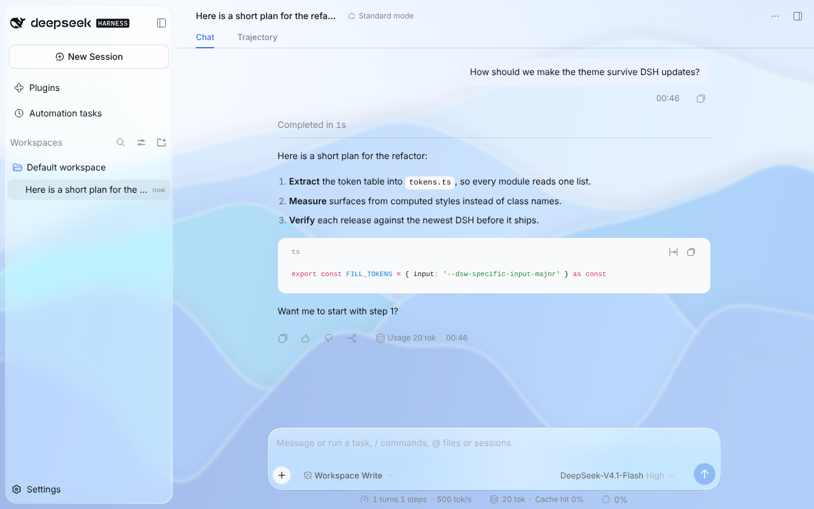
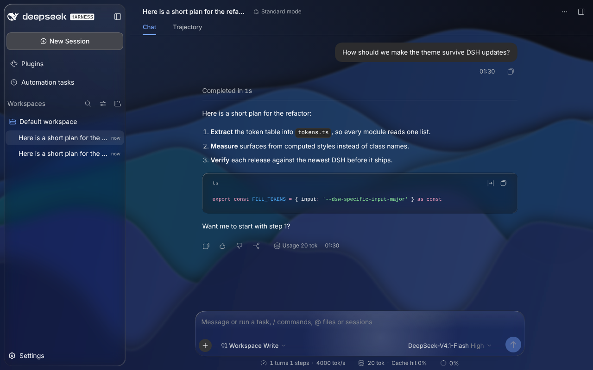
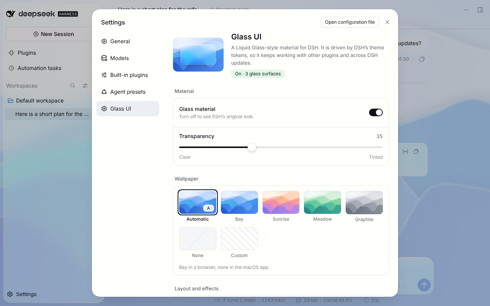
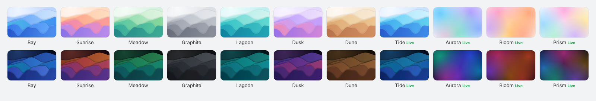

# Glass UI for DSH

**A Liquid Glass–style material for DSH (DeepSeek Harness) Web.** Translucent, blurred and refracting glass for the sidebar, composer, dialogs, menus and toasts — over a wallpaper of your choice. An unofficial plugin, independent of DeepSeek and Apple.

[日本語](README.ja.md)



<table>
  <tr>
    <td></td>
    <td></td>
  </tr>
</table>

## Highlights

- **Follows DSH, not its markup.** Surfaces are found by the design tokens DSH paints them with (`--dsw-*`), never by class names, Compatibility checks and tests against real DSH detect changes to those tokens and APIs.
- **Stays out of the way.** Theme overrides on `<body>` take precedence. You can exclude individual elements, or turn glass off without reloading.
- **Fast.** No per-frame work while idle; DOM changes are scanned in time-sliced batches and rendered Markdown is skipped entirely.
- **Accessible.** Honors _reduce transparency_, _increase contrast_, _reduce motion_ and Windows high-contrast mode. Code blocks become a denser glass that keeps syntax colors legible — or stay solid, if you prefer.
- **Real refraction where the browser can do it.** In Chromium-based browsers the edges of the composer, menus and toasts bend the background like a lens. Elsewhere you get the same glass without the lens.
- **Eleven wallpapers, four of them alive.** Ribbons and soft color fields in light and dark variants; the _Live_ ones drift slowly, redrawing the page only 12 times a second and holding still with _reduce motion_.
- **Local wallpapers, no telemetry.** Wallpapers are small inline SVGs. The Host contacts the fixed GitHub release service only when you request an update check or install.

## Install

Requires DSH `>=0.2.0-rc.2 <0.3.0-0`. DSH admits prereleases in that range, including 0.2.1-alpha.3 and later 0.2.x prereleases, and excludes 0.3.0 prereleases. An empty peer range, a wildcard (`*`, `x`, `>=0`), a range missing either end (`<0.3.0-0`, `<=0.2.9`, `<0.2.2`), or a range that leaves the running line (`>=0.0.0 <0.3.0-0`, `<99`, `^0`, or `<0.3.0` on 0.2) is treated as compatibility-unknown. Browser-tested with 0.2.0-rc.2 and 0.2.1-rc.2 (`next`); token and API contracts also checked on 0.2.1-alpha.5 (`alpha`).

1. In DSH Web, open **Plugins → Add plugin** and enter `github:Aero123421/dsh-glassui#v0.2.6`.
2. Or install from a terminal:

   ```sh
   dsh plugin --profile web add github:Aero123421/dsh-glassui#v0.2.6
   ```

3. Restart DSH if it asks you to, then reload DSH Web. The glass is on by default; **Settings → Glass UI** has the controls.

Japanese display requires dsh-japanese (日本語の表示には dsh-japanese が必要). This plugin registers its English, Japanese and Chinese dictionaries and does not add the `ja` language. Install [dsh-japanese](https://github.com/Aero123421/dsh-japanese) and choose 日本語. Until that pack is installed, DSH lists 中文 and English, and Glass UI stays in English. zh-CN uses the Chinese dictionary bundled here.

The [release tarball](https://github.com/Aero123421/dsh-glassui/releases/latest) can also be installed by its URL. Both distributions include the compiled plugin.

To remove it, uninstall it from **Plugins** (or `dsh plugin --profile web remove dsh-glassui`).

## Settings

Settings are applied and stored in your DSH profile, so they are also available on the Plugins page and in the configuration file.

| Setting                    | Default   |                                                                                                                                                                                                                                              |
| -------------------------- | --------- | -------------------------------------------------------------------------------------------------------------------------------------------------------------------------------------------------------------------------------------------- |
| Glass material             | on        | Master switch. Off restores DSH's own look immediately.                                                                                                                                                                                      |
| Transparency               | 35        | 0 is ultra clear, 100 fully tinted.                                                                                                                                                                                                          |
| Wallpaper                  | Automatic | Bay, Sunrise, Meadow, Graphite, Lagoon, Dusk, Dune, the moving Tide, Aurora, Bloom and Prism, none, or a custom image. _Automatic_ uses Bay in a browser and no wallpaper in the macOS desktop app, whose window already shows your desktop. |
| Custom wallpaper URL       | —         | An `http://` or `https://` URL, a path on the DSH server, or a base64 image `data:` URL.                                                                                                                                                     |
| Sidebar                    | Floating  | _Floating_ insets the sidebar as a rounded pane; _Docked_ keeps DSH's layout.                                                                                                                                                                |
| Code blocks                | Glass     | _Glass_ is a denser tint that keeps code easy to read; _Solid_ keeps DSH's opaque code blocks.                                                                                                                                               |
| Inline-code opacity        | 72        | Independent background opacity (0–100) with a live text preview; 60–85 is recommended. Contrast preferences can raise the effective opacity.                                                                                                 |
| Refraction                 | on        | Lens refraction along glass edges (Chromium-based browsers).                                                                                                                                                                                 |
| Pointer highlights         | on        | A soft light that follows the mouse across glass. Off on touch screens and with _reduce motion_.                                                                                                                                             |
| Leave these elements alone | —         | CSS selectors of elements the plugin must not style, e.g. `.my-plugin-panel`.                                                                                                                                                                |

Sliders preview immediately in their own sample while you drag. Release to apply the value across the page; keyboard edits apply immediately. This keeps dragging responsive without rebuilding every glass surface for each input.

The settings page also shows a short diagnostic report (surfaces found, tokens missing, scan cost) with a copy button for bug reports.

### Wallpapers



_Live_ wallpapers move a few large layers on the compositor; nothing runs on the main thread while they play. They step a dozen times a second, which is smooth at their slow pace and lets the browser redraw the glass above them at a fifth of the display's refresh rate. With _reduce motion_ they show their first frame.

## Plugin updates

Settings → Glass UI shows the running version and **Check plugin update**. Checking and installing are separate actions. Before installing, pending settings writes are saved; refused writes and settings changed in another window stop the update.

The Host checks a fixed GitHub stable release, DSH peer ranges, bounded downloads, SHA-256 and the archive manifest. It hands that exact verified tarball to DSH’s plugin manager, without removing the current plugin first. Settings and bundle ON/OFF are kept. Updates from both GitHub and release-tarball installations are pinned to the verified archive in the profile’s `.dsh-glassui-updates/` directory. Keep an archive while the profile references it. Development paths and read-only profiles use the linked manual update.

An operation ID reconciles a lost response without installing again. The UI checks installed and running versions before reporting success, or asks for a Host restart when needed. A manager refusal leaves the current installation in place; use the manual update instructions rather than removing it.

**Updating from v0.2.3 or earlier:** stop DSH, run the install command above for v0.2.6, then start DSH and reload Web. This avoids the old updater’s remove-then-install path. Old recovery journals remain readable while the plugin is installed; if an old update already left the plugin absent, install it through Plugins or the CLI.

## For plugin authors

Your plugin does not need to know about Glass UI. Panels using the watched DSH tokens and elevations can be discovered automatically. If you want control:

```html
<!-- Never touch this element or anything inside it. -->
<div data-glassui-ignore>…</div>

<!-- Ask for glass explicitly: regular, dense or smoke. -->
<div data-glassui-material="dense">…</div>
```

Token overrides applied through DSH's theme API (`ctx.theme.overrideTokens`) are inline values on `<body>` and always take precedence over this plugin; glass is mixed from whatever value is in effect, so your colors show through it.

## Browser support

| Browser                                                                          | Glass | Refraction |
| -------------------------------------------------------------------------------- | ----- | ---------- |
| Chrome, Edge, Brave, Arc, Opera (Chromium 111+, tested with 141/143/149/154/156) | ✓     | ✓          |
| DSH desktop app                                                                  | ✓     | ✓          |
| Safari 16.4+                                                                     | ✓     | —          |
| Firefox 115+                                                                     | ✓     | —          |

Without `backdrop-filter`, surfaces fall back to nearly opaque fills so text stays readable.

While glass is on, the composer placeholder and the labels under the input (the permission mode, such as Workspace Write, and the model name) use plugin colors (`#4f5459` in light, `#d4d8de` in dark). `#d4d8de` is darker than typed text (`#f3f4f6`) and at least as light as DSH's secondary gray `#cfd3d6`. The light composer fill is at least 0.74. The dark composer uses the normal fill, with no 0.74 floor. On a white wallpaper the dark model name is 2.17:1 at tint 0 and 4.56:1 at tint 35, so tint 0 is under 4.5:1. Turning glass off restores DSH's own colors. On DSH 0.2.1-rc.2 the restored light placeholder (`#adb2b8`) is 2.13:1 on white, and the dark caption on the dark input is 3.76:1 (an earlier reading of that caption was 3.61:1). This plugin leaves that glass-off rendering as DSH draws it. The model button's effort label and the 1017 badge keep DSH's colors. That effort label is under 3:1 in all eight light conditions (1.50:1 on black at tint 0) and in five dark conditions: Bay at tint 0 (2.39:1), white at tint 0 (1.19:1), gray `#808080` at tint 0 (2.13:1), white at tint 35 (1.76:1), and gray `#808080` at tint 35 (2.99:1). Dark black is 5.22:1 at tint 0 and 4.79:1 at tint 35, and dark Bay at tint 35 is 3.20:1. If a later DSH release no longer matches these composer selectors, the plugin colors do not apply and DSH's own colors remain.

## How it works

The Host half adds three rows to every DSH Web page: the settings, a static stylesheet and a tiny script that marks `<html>` before the first paint. The browser half then discovers surfaces by reading computed styles: each watched fill token is nudged by one 8-bit step so its color is unique, and an element whose background matches that color is the surface that token paints. The engine tags it with `data-glassui-*` attributes, and the stylesheet — scoped under `:root[data-glassui]` — turns tagged surfaces into glass by redefining the tokens on them with `color-mix()`.

Details, including the refraction filter and the precedence rules, are in [docs/architecture.md](docs/architecture.md). How compatibility with new DSH releases is checked is in [docs/compatibility.md](docs/compatibility.md).

## Development

```sh
npm ci
npm run check             # typecheck, lint, format, unit tests, build
npm run test:integration  # the built plugin on a DSH-like page in Chromium
npm run test:e2e          # the packed plugin in a real DSH from npm
npm run compat -- --install alpha
```

See [docs/development.md](docs/development.md) and [CONTRIBUTING.md](CONTRIBUTING.md).

## License

[MIT](LICENSE). Glass UI is an independent project, not affiliated with or endorsed by DeepSeek or Apple; see [NOTICE.md](NOTICE.md).
