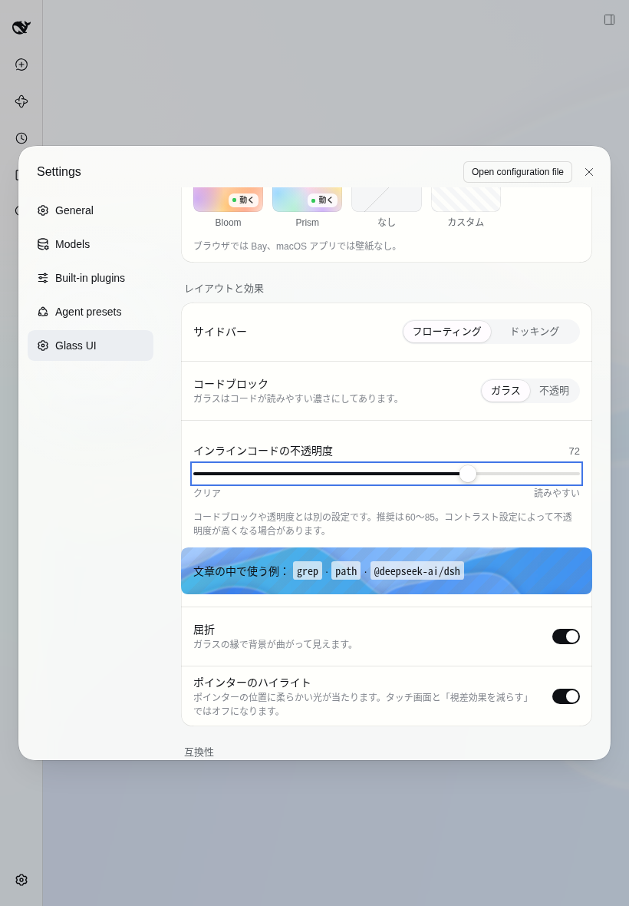

# 0.2.2

インラインコードを周囲のテーマに馴染ませ、独立した不透明度設定と文章プレビューを追加しました。透明度操作と会話更新の内部処理も軽量化しています。

## 設定と互換性

- インラインコードの既定不透明度は72、範囲0〜100、推奨60〜85。既存の透明度とコードブロックのGlass/Solidは独立です。古い設定には72を補い、明暗テーマを切り替えても値を保持します。
- 標準のインラインコード用テーマトークンを使います。body上の明示的なテーマ上書き、コンポーネント固有の上書き、除外領域、プラグインOFFを尊重します。
- コントラスト増加と透過削減は既存の不透明度下限を適用します。強制カラーではDSH本来の描画を保ちます。
- 機能の自動OFF、屈折サポート判定の変更、画質や地図解像度、更新頻度、12ステップ/秒の壁紙モーション、保存の300ms debounceを変えていません。

## 性能の前後測定

基準commit: `2aeb4f4`（0.2.0）。比較対象: 0.2.2のエンジン変更。初回比較は両側Playwright 1.56.1で行い、依存更新とroot背景保護を含む `9f123be` でも同じChromiumで16条件を再測定しました。再測定の同期更新中央値は0.1〜0.2ms、Bayのフレーム間隔p95は22〜43ms、静止8条件はピクセル一致しています。

Linuxコンテナ、Chromium 154.0.8037.57、Playwright 1.56.1、Node 24.19.0、同じDSH相当のテーマ・実配布bundleで測定しました。1800行の会話を表示し、透明度0〜100を1値ずつ毎requestAnimationFrameに反映、その後60行を1行ずつ追加します。Light/Dark × Bay/Tide × 屈折ON/OFF × 1440×900/820×1180の16条件です。viewportの比較はタブレット実機の再現ではありません。実React設定画面のrender時間はこの数値に含みません。

DevTools trace（devtools.timelineとblink.user_timing）、Performanceメトリクス、同期更新時間、フレーム間隔、描画値読み取り・文書query回数を保存しました。前後の測定は他のブラウザー試験と並行させていません。1回の掃引なので統計的な安定性や実機の最大性能は保証しません。

| 条件                    | 同期更新中央値 ms（前→後） | 同期更新p95 ms（前→後） | フレーム間隔p95 ms（前→後） |
| ----------------------- | -------------------------: | ----------------------: | --------------------------: |
| desktop-light-bay-blur  |               12.30 → 0.10 |            20.30 → 0.30 |                276.5 → 23.5 |
| desktop-light-bay-lens  |               13.00 → 0.20 |            21.10 → 0.40 |                283.8 → 41.3 |
| desktop-light-tide-blur |                8.30 → 0.10 |            12.00 → 0.20 |                 36.1 → 31.9 |
| desktop-light-tide-lens |                9.30 → 0.20 |            12.50 → 0.40 |                 52.4 → 45.5 |
| desktop-dark-bay-blur   |               10.40 → 0.10 |            14.40 → 0.30 |                241.5 → 22.4 |
| desktop-dark-bay-lens   |                9.70 → 0.20 |            15.60 → 0.40 |                223.9 → 38.6 |
| desktop-dark-tide-blur  |                8.40 → 0.10 |            11.10 → 0.30 |                 28.6 → 27.0 |
| desktop-dark-tide-lens  |               10.00 → 0.20 |            11.50 → 0.30 |                 49.4 → 50.8 |
| tablet-light-bay-blur   |               10.10 → 0.10 |            14.80 → 0.20 |                175.7 → 24.0 |
| tablet-light-bay-lens   |               11.00 → 0.20 |            27.60 → 0.30 |                200.9 → 28.6 |
| tablet-light-tide-blur  |                7.80 → 0.10 |            11.00 → 0.20 |                 26.2 → 26.2 |
| tablet-light-tide-lens  |                8.40 → 0.20 |            12.00 → 0.30 |                 34.0 → 28.2 |
| tablet-dark-bay-blur    |                9.10 → 0.10 |            14.00 → 0.30 |                176.9 → 22.2 |
| tablet-dark-bay-lens    |               10.40 → 0.20 |            16.10 → 0.30 |                181.8 → 24.1 |
| tablet-dark-tide-blur   |                8.00 → 0.10 |            11.00 → 0.30 |                 27.5 → 33.3 |
| tablet-dark-tide-lens   |               11.00 → 0.20 |            13.30 → 0.30 |                 32.0 → 32.0 |

同期更新内の描画値読み取りは屈折OFFで101→0回、ONで505→0回。更新後のメニューは新しい候補を分類する直前に最新フィルターを照合します。会話追加時の文書全体queryは30→0回。任意のCSS除外セレクターの評価は従来どおり全体を調べます。

静止Bay壁紙8条件の前後スクリーンショットはピクセル一致しました。この画面ではインラインコードがスクロール外にあり、意図したインラインコードの変更は別のintegration/native検証で確認します。動く壁紙のピクセル一致は時刻依存のため主張せず、既存モーション・描画頻度の回帰試験で確認します。

同期処理は改善しましたが、フレーム間隔とStyle/Paintには条件ごとの変動が残ります。静止SVG壁紙を専用compositor layerで再利用する変更により、Bayのフレーム間隔p95は約176〜284msから約22〜41msへ改善しました。動く壁紙には変動が残り、全端末でのスムーズさを達成したとは判断しません。TraceとPerformanceはブラウザーのCPU側の観測であり、実GPU使用率・電力・画像メモリの測定を代替しません。

## diffレビュー

キャッシュの対象は内蔵の静止壁紙です。カスタム画像はGIF/APNG/WebP等のアニメーションの時刻を保つため、従来のroot描画を維持します。

静止壁紙は解像度やSVGを変えず、元のcover配置を専用レイヤーで再利用します。透明なgradientをrootに残してbody背景の伝播を保ち、元と同じ色で合成します。元のroot SVGを使った表示とのピクセル一致、DPR2・回転、印刷、解除、rootへの明示的背景上書きの回帰試験を追加しました。

設定の正規化→Host→boot→Client→保存・更新前照合を追跡し、除外とテーマ優先順位、解除時の復元、遅延メニュー検出、環境設定とリサイズ、キャッシュ寿命を確認しました。

レビュー中に壁紙一覧のmemo化による言語切替停止を検出し、localeのrevisionに対応する翻訳callbackへ修正しました。診断の手動コピー欄は更新を続け、JSON生成は通常のドラッグ中には行いません。旧DSHのCIで更新ボタンの矩形を別々のフレームから読む問題も検出し、同じフレーム内の一括計測と狭い幅でのborder-boxに修正しました。固定版を期待していたHostテストはmanifestから版を読むよう変更し、新しい設定も更新前照合に含めました。

## 検証と残る範囲

ローカルの `npm run check`（unit 142件）、Chromium integration（58件）、実DSH 0.2.1-alpha.2／0.2.0-rc.2へのクリーンtgz導入native E2E（各14件）、保存・再読込、日英中、390px・820px、DPR2とタッチ・回転、compatとpackが成功しました。画面操作は実DSHのnative E2Eを根拠にしています。

ローカルではGitHub APIへのアクセスが制限されるため、alphaのnative試験に `GLASSUI_E2E_EXPECT_RELEASE_NETWORK_ERROR=1` を明示し、network拒否の説明と以後のwire fixtureによる更新操作を検証しました。GitHub CIではこのフラグを指定せず、live Releaseの確認を必須にしています。

Issue #6/#7の修正を含みます。#8は今回の静止壁紙レイヤー再利用、差分探索、ポインターread/write整理、壁紙一覧のmemo化、診断JSONの遅延生成、カスタム壁紙キャッシュの上限追加を第一段階とし、全体性能の追跡を継続します。#9はDPR2・タッチ・回転のエミュレーションを追加しましたが、実iPadOS Safari/PWA・Android Chrome/PWA、GPU/電力/温度、復帰と長時間利用は未検証なので完了扱いしません。
